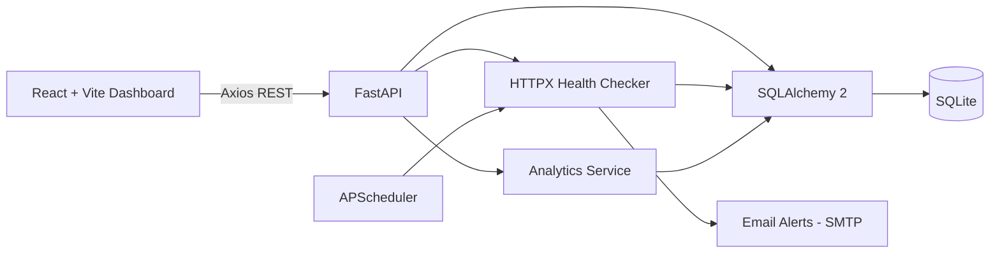

# PulseWatch — API Health Monitoring & Reliability Dashboard

PulseWatch is a self-hosted application that monitors HTTP/HTTPS endpoints, records health checks, and displays service status, response times, and incidents in a React dashboard. It sends email alerts when a service becomes degraded, goes down, or recovers.

Built with **React + Vite** on the frontend and **FastAPI + SQLAlchemy + SQLite** on the backend, PulseWatch includes automated tests and a GitHub Actions CI pipeline.

## Features

### Monitoring

- Add, edit, delete, enable, and disable HTTP/HTTPS monitors.
- Configure check intervals from 30 seconds to 24 hours.
- Run automatic checks with APScheduler. Due checks run concurrently so a slow endpoint does not delay other monitors.
- Trigger an instant check using the **Check now** button.
- View each monitor's check history, including timestamp, status, HTTP code, latency, and error message.
- Search monitors by name or URL and filter by status.

### Health Classification

- **HEALTHY:** HTTP 200–399 and response time within the configured threshold.
- **DEGRADED:** HTTP 4xx/5xx response, slow response, or response larger than the configured size limit.
- **DOWN:** DNS failure, connection failure, timeout, or blocked destination.
- Measure latency using `time.perf_counter()`. DOWN checks store no latency, keeping failed requests out of response-time averages.

### Dashboard & Analytics

- View total monitors, healthy, degraded, and down counts, average response time, and 24-hour availability.
- View average response time in 30-minute intervals over the last 24 hours.
- View service health in a donut chart.
- Refresh dashboard data automatically every 15 seconds.
- See the API connection status in the sidebar.
- Review degraded and down checks on the Incidents page.
- Switch between light and dark themes. The selected theme is remembered, with the system theme used by default.

### Email Alerts

- Send email alerts when a monitor changes to **DOWN**, **DEGRADED**, or **HEALTHY**.
- Avoid repeated alerts for an unchanged status. The first-ever healthy check does not send an alert.
- Send a test email from the Alerts page and view the actual SMTP error if delivery fails.
- Support SMTP providers using STARTTLS, SSL, or no encryption.
- Send emails in a background thread so a slow mail server does not delay health checks.

### Security

- Provide single-owner login using a signed, expiring token.
- Require authentication for all API routes except `/api/health` and `/api/auth/login`.
- Refuse login when no password is configured.
- Protect monitored URLs against SSRF:
  - Allow only HTTP and HTTPS.
  - Reject embedded credentials.
  - Block localhost and internal hostnames.
  - Block private or non-global IP addresses, including IPv4-mapped IPv6.
  - Disable redirects.
  - Enforce request timeouts and response size limits.
- Keep secrets in the git-ignored `backend/.env` file.

### Reliability & Data

- Automatically remove old check history using `RETENTION_DAYS` (default: 30).
- Store and return timestamps as timezone-aware UTC.
- Automatically delete a monitor's history when the monitor is deleted.
- Use SQLite, so no separate database server is required.

## Tech Stack

| Layer            | Technology                                                       |
| ---------------- | ---------------------------------------------------------------- |
| Frontend         | React 19, Vite, React Router, Axios, Recharts, Lucide icons      |
| Backend          | Python 3.12, FastAPI, Pydantic, SQLAlchemy 2, HTTPX, APScheduler |
| Database         | SQLite                                                           |
| Backend Testing  | Pytest                                                           |
| Frontend Testing | Vitest, Testing Library                                          |
| CI               | GitHub Actions                                                   |

## Architecture



### How a Check Works

Every 15 seconds, the scheduler finds monitors whose configured check interval has elapsed. Each due monitor is checked concurrently.

The checker:

1. Validates the URL using SSRF protection rules.
2. Sends a GET request with a configured timeout.
3. Classifies the result as HEALTHY, DEGRADED, or DOWN.
4. Stores the health check in the database.
5. Updates the monitor's latest status.
6. Sends an email alert if the monitor's status changes.

## Project Structure

```text
PulseWatch/
├── backend/
│   ├── app/
│   │   ├── api/          # Auth, monitors, dashboard, incidents, and alerts routes
│   │   ├── services/     # Checker, scheduler, analytics, alerts, auth, and security
│   │   ├── config.py     # Settings loaded from backend/.env
│   │   ├── database.py   # SQLAlchemy engine and session
│   │   ├── models.py     # Monitor and HealthCheck tables
│   │   ├── schemas.py    # Pydantic request/response models
│   │   └── main.py       # FastAPI application entry point
│   ├── tests/            # 77 backend tests
│   ├── .env.example
│   ├── requirements.txt
│   └── requirements-dev.txt
├── frontend/
│   ├── src/              # Pages, components, context, services, and tests
│   ├── .env.example
│   └── package.json
├── .github/
│   └── workflows/
│       └── ci.yml
└── README.md
```

## Getting Started

### Prerequisites

- Python 3.12
- Node.js LTS
- Git

### 1. Clone the Repository

```powershell
git clone <repository-url>
cd PulseWatch
```

### 2. Set Up the Backend

```powershell
cd backend
py -3.12 -m venv .venv
.\.venv\Scripts\Activate.ps1
python -m pip install --upgrade pip
pip install -r requirements-dev.txt
Copy-Item .env.example .env
```

Edit `backend/.env` and configure `AUTH_PASSWORD` and `SECRET_KEY`.

Start the backend:

```powershell
uvicorn app.main:app --reload
```

### 3. Set Up the Frontend

Open a second PowerShell window from the project root:

```powershell
cd .\frontend
npm install
Copy-Item .env.example .env
npm run dev
```

### 4. Open the Application

- **Dashboard:** http://localhost:5173
- **API Documentation:** http://localhost:8000/docs

Sign in using the `AUTH_USERNAME` and `AUTH_PASSWORD` configured in `backend/.env`.

The SQLite database and tables are created automatically when the backend starts for the first time.

**macOS/Linux:** Use `python3 -m venv .venv && source .venv/bin/activate` to create and activate the virtual environment, and `cp .env.example .env` to copy environment files.

## Configuration

Backend settings are configured in `backend/.env`. Start with `backend/.env.example`.

| Variable                  | Purpose                                                         |
| ------------------------- | --------------------------------------------------------------- |
| `DATABASE_URL`            | Database connection; defaults to `sqlite:///./pulsewatch.db`    |
| `CORS_ORIGINS`            | Allowed frontend origin; defaults to `http://localhost:5173`    |
| `REQUEST_TIMEOUT_SECONDS` | Health-check request timeout; default: 8 seconds                |
| `LATENCY_THRESHOLD_MS`    | Response time above which a check is DEGRADED; default: 1500 ms |
| `MAX_RESPONSE_BYTES`      | Maximum response size; default: 65536 bytes                     |
| `SCHEDULER_ENABLED`       | Enables or disables scheduled checks                            |
| `RETENTION_DAYS`          | Number of days to retain check history; default: 30             |
| `AUTH_USERNAME`           | Login username                                                  |
| `AUTH_PASSWORD`           | Login password                                                  |
| `SECRET_KEY`              | Key used to sign login tokens                                   |
| `TOKEN_TTL_HOURS`         | Login token lifetime; default: 12 hours                         |
| `SMTP_HOST`               | SMTP server hostname                                            |
| `SMTP_PORT`               | SMTP server port                                                |
| `SMTP_SECURITY`           | SMTP security mode: `starttls`, `ssl`, or `none`                |
| `SMTP_USERNAME`           | SMTP username                                                   |
| `SMTP_PASSWORD`           | SMTP password; use a Gmail App Password for Gmail               |
| `ALERT_EMAIL_FROM`        | Alert sender email address                                      |
| `ALERT_EMAIL_TO`          | Alert recipient email address                                   |

Generate a secret key using:

```powershell
python -c "import secrets; print(secrets.token_hex(32))"
```

The frontend API URL is configured through `VITE_API_URL` in `frontend/.env`.

Default value:

```env
VITE_API_URL=http://localhost:8000/api
```

Restart the backend after changing environment settings.

## Running the Tests

### Backend Tests

```powershell
cd .\backend
.\.venv\Scripts\Activate.ps1
pytest -q
```

### Frontend Tests

```powershell
cd ..\frontend
npm test
npm run build
```

The GitHub Actions workflow in `.github/workflows/ci.yml` automatically runs both test suites and the frontend build on every push.

**Project Test Suites:**

- Backend: 77 tests
- Frontend: 25 tests

## API Endpoints

All endpoints require a bearer token except the public endpoints marked below.

| Method | Endpoint                                       | Description                             |
| ------ | ---------------------------------------------- | --------------------------------------- |
| GET    | `/api/health`                                  | API health check (Public)               |
| POST   | `/api/auth/login`                              | User login (Public)                     |
| GET    | `/api/auth/me`                                 | Get authenticated user                  |
| GET    | `/api/alerts/config`                           | Get alert configuration                 |
| POST   | `/api/alerts/test`                             | Send a test email                       |
| POST   | `/api/monitors`                                | Create a monitor                        |
| GET    | `/api/monitors`                                | List monitors with latest check details |
| GET    | `/api/monitors/{id}`                           | Get monitor details                     |
| PUT    | `/api/monitors/{id}`                           | Update a monitor                        |
| DELETE | `/api/monitors/{id}`                           | Delete a monitor and its history        |
| POST   | `/api/monitors/{id}/check`                     | Run a manual health check               |
| GET    | `/api/monitors/{id}/history?limit=50&offset=0` | Get monitor check history               |
| GET    | `/api/dashboard/stats`                         | Get dashboard statistics                |
| GET    | `/api/dashboard/response-times`                | Get response-time analytics             |
| GET    | `/api/incidents?limit=100`                     | List degraded and down checks           |

## Availability Calculation

24-hour availability is calculated using:

```text
HEALTHY / (HEALTHY + DEGRADED) × 100
```

DOWN checks are excluded because they do not contain a valid HTTP response to evaluate.

If there are no applicable checks, availability is displayed as empty rather than 0%.

Availability is based on periodic samples and does not prove continuous uptime between checks.
